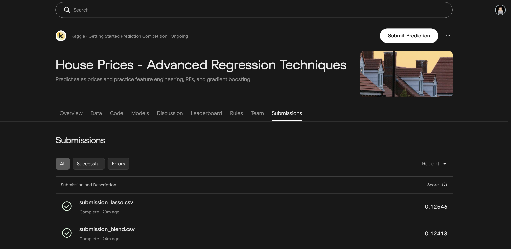

# House Prices: Advanced Regression Techniques

**Author:** Aksel Aghajanyan  
**Course:** Picsart AI/ML Course, Classical Machine Learning, Final Project  
**Competition:** [Kaggle: House Prices - Advanced Regression Techniques](https://www.kaggle.com/competitions/house-prices-advanced-regression-techniques)

## The problem

Predict the sale price of 1459 houses in Ames, Iowa, from 79 facts about each house (size, quality, location, age, garage, basement, ...). We have 1460 houses with a known price for training. The score is the RMSE on the log of the price (lower is better).

## Final result

| | |
|---|---|
| **Best Kaggle score** | **0.12413** (blend of Lasso and Gradient Boosting) |
| Best single model | Lasso (tuned), CV RMSE 0.1099 |
| Baseline (always predict the mean) | CV RMSE 0.3993 |



## Project structure

```
house-prices-aksel-aghajanyan/
├── data/
│   ├── raw/                      # the 4 original Kaggle files, never edited
│   │   ├── data_description.txt
│   │   ├── sample_submission.csv
│   │   ├── test.csv
│   │   └── train.csv
│   └── processed/                # saved by 01_EDA.ipynb
│       ├── test_processed.csv
│       └── train_processed.csv
├── notebooks/
│   ├── 01_EDA.ipynb              # Part B: explore, clean, new columns
│   └── 02_Models.ipynb           # Part C: models, winner, submission
├── results/
│   ├── figures/                  # the best plots (.png)
│   └── model_comparison.csv      # all models and their CV scores
├── submissions/
│   ├── kaggle_score.png          # screenshot of the Kaggle score
│   ├── submission_blend.csv      # best Kaggle score (0.12413)
│   └── submission_lasso.csv      # winner of cross-validation (0.12546)
└── README.md
```

## How to run

1. Install Python 3.10 or newer and the libraries:
   ```
   pip install numpy pandas matplotlib seaborn scikit-learn scipy jupyter xgboost
   ```
   (`xgboost` is optional: without it, `02_Models.ipynb` skips the XGBoost model and still runs.)
2. Put the 4 Kaggle files in `data/raw/`.
3. Open the `notebooks/` folder and run the notebooks **in this order** (Kernel → Restart & Run All):
   1. `01_EDA.ipynb` creates `data/processed/train_processed.csv` and `test_processed.csv`, and the EDA figures.
   2. `02_Models.ipynb` creates `results/model_comparison.csv`, the model figures and the files in `submissions/`.
4. Upload a file from `submissions/` on Kaggle (*Submit Prediction*).

All random steps use `random_state = 42`, so the results are the same every run.

## Part B: EDA and data preparation (`01_EDA.ipynb`)

1. **Target.** `SalePrice` is skewed to the right (skew 1.88). After `log1p` it is almost symmetric (skew 0.12), so all models predict the log of the price.
2. **Missing values.** 19 columns in train and 33 in test had gaps. Most of them mean "the house does not have it" (no pool, no garage, ...), so they were filled with `"None"` or `0`. `LotFrontage` was filled with the median of its neighborhood, the rest with the most common value. All fill values were learned on train only. Result: 0 missing values.
3. **Visualizations.** Quality (`OverallQual`, correlation 0.79), size (`GrLivArea`, `TotalBsmtSF`, garage) and location (`Neighborhood`) drive the price most.
4. **Outliers.** 2 houses (Id 524 and 1299) are the biggest in the data but sold for an average price (partial sales). They were removed from train only. The correlation of `GrLivArea` with the price rose from 0.709 to 0.735.
5. **New features.** `TotalSF`, `HouseAge`, `RemodAge`, `TotalBath`, `TotalPorchSF`, `HasGarage`. `TotalSF` (correlation 0.833) is stronger than each of its parts and than `GrLivArea`.
6. **Encoding.** Near-constant and unhelpful columns were dropped. Train and test were one-hot encoded together, so both have the same 305 feature columns.

## Part C: Models (`02_Models.ipynb`)

All models are compared with the same 5-fold cross-validation (`KFold(shuffle=True, random_state=42)`), RMSE on `log1p(SalePrice)`. Before modeling, `log1p` was applied to 21 skewed numeric features.

| Model | CV RMSE | Std |
|---|---|---|
| **Blend (Lasso + Gradient Boosting)** | **0.1079** | 0.0071 |
| **Lasso (tuned, alpha = 0.0005)** | **0.1099** | 0.0074 |
| ElasticNet | 0.1112 | 0.0077 |
| Ridge (tuned, alpha = 10) | 0.1120 | 0.0083 |
| Gradient Boosting (tuned, max_depth = 4, learning_rate = 0.03) | 0.1139 | 0.0069 |
| XGBoost | 0.1146 | 0.0077 |
| Random Forest | 0.1360 | 0.0068 |
| Baseline (mean) | 0.3993 | 0.0168 |

The full table is in `results/model_comparison.csv`.

**Main findings**
- **Winner: the tuned Lasso.** It has the lowest CV RMSE of the single models, uses only 109 of the 305 features, and is easy to explain. Linear models with a penalty fit this data well, because the log price is close to linear in quality and size.
- **The top models are very close:** the differences are smaller than the std over the folds.
- **The blend is the best overall**, because a linear model and a tree model make different mistakes.
- **The log of skewed features** helped the linear models (Lasso 0.1118 → 0.1099) and avoided a crazy prediction for one giant test house (Id 2550: \$1.67M → \$867k).
- **The new features help the tree models** (Gradient Boosting 0.1154 → 0.1137) but not Lasso, which can build sums of columns by itself.
- **Error analysis:** the median error is about \$8,900 (5.5%). The biggest errors in dollars are on very expensive houses; in % the cheap houses and old neighborhoods (`IDOTRR`, `ClearCr`, `OldTown`) are the hardest.

## Kaggle submissions

| Submission | Kaggle score |
|---|---|
| Lasso, first try (without the log of skewed features) | 0.13333 |
| Lasso (with the log of skewed features) | 0.12546 |
| **Blend of Lasso and Gradient Boosting** | **0.12413** |

The order on Kaggle is the same as in cross-validation (blend better than Lasso), so the cross-validation was a reliable guide.

## Sources

- Data: [Kaggle: House Prices - Advanced Regression Techniques](https://www.kaggle.com/competitions/house-prices-advanced-regression-techniques), with `data_description.txt`
- Libraries: pandas, NumPy, matplotlib, seaborn, scikit-learn, SciPy, XGBoost
- Course materials: Picsart AI/ML Course

### AI tools used

AI tools were allowed in this project. I used them as follows:

- **My own work:** the project setup, the complete EDA in `01_EDA.ipynb` (cleaning, missing values, visualizations, outliers, new features, and encoding), the plan and model choice for `02_Models.ipynb`, running all notebooks, and the Kaggle submissions.
- **Claude (Anthropic) as an assistant:** drafting this README. Claude also helped me write the documentation, create the presentation, and write text.

I ran, checked, and can explain every step of both notebooks.
